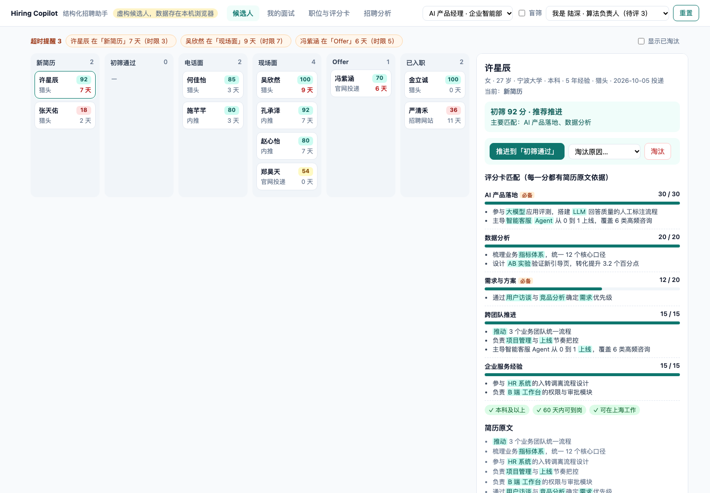
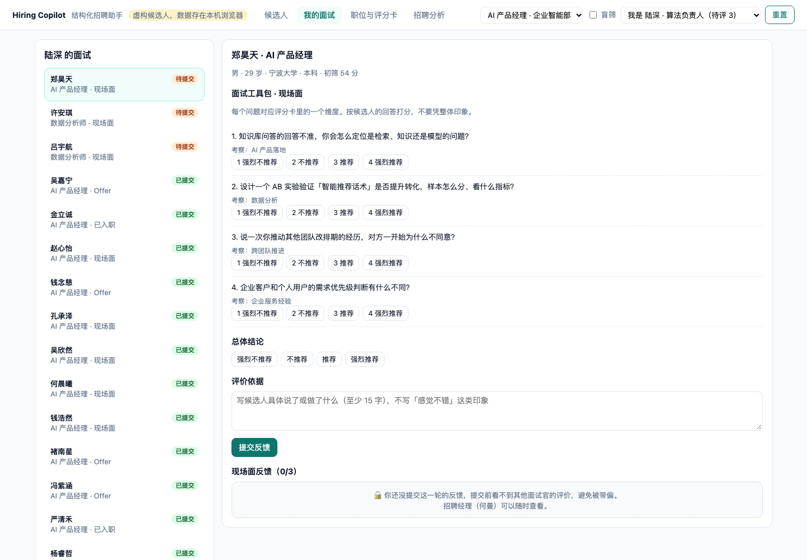
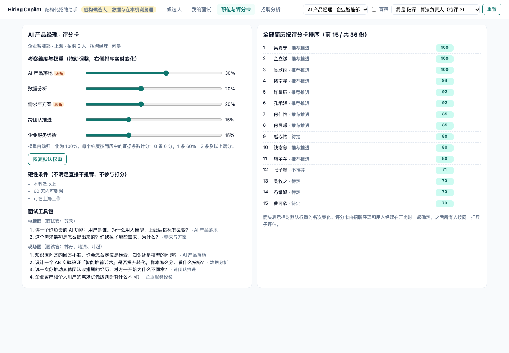
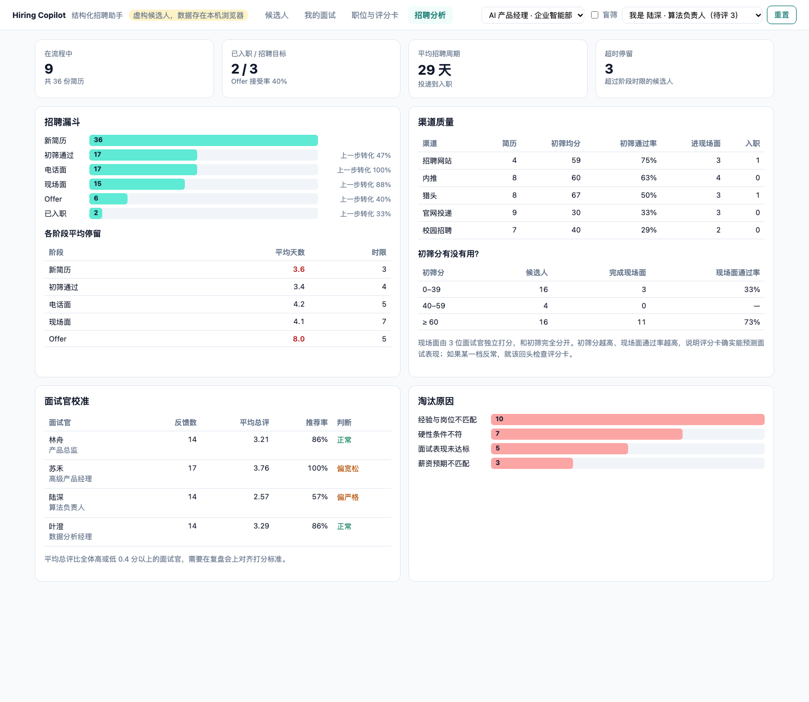
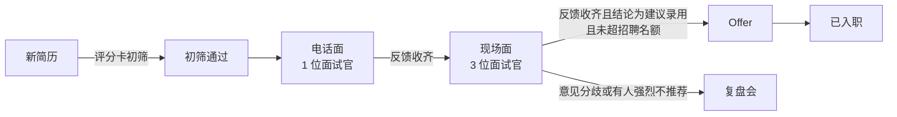

# Hiring Copilot · 结构化招聘助手

**参考 Greenhouse、Ashby、Lever 的结构化招聘方法做的招聘工作台：评分卡驱动初筛，每一分都能指到简历原文；面试官按工具包独立打分，提交前看不到别人的评价；数据再反过来检验评分卡和面试官准不准。**

[在线体验](https://annawzhang.github.io/hiring-copilot/) · [浏览器内测试](https://annawzhang.github.io/hiring-copilot/tests.html) · 原生 JavaScript，无依赖、无构建

> 职位、候选人、面试官均为虚构；数据保存在你自己的浏览器（localStorage），右上角「重置」可恢复初始状态。



## 学的是什么

招聘系统里最值得学的不是看板，而是 Greenhouse 一直在推的「结构化招聘」：开岗时先定义评什么，之后所有人用同一把尺子。
这个项目把它拆成四条可以验证的规则：

| 优秀产品的做法 | 这里的实现 |
|---|---|
| 开岗先建评分卡（Scorecard） | 每个职位 5 个考察维度，带权重和「必备」标记，外加硬性条件；权重可拖动，排序实时变化 |
| 初筛要讲依据，不要黑箱 | 每个维度列出命中的简历原句并高亮关键词；缺必备能力只给「待定」，硬性条件不符直接「不推荐」 |
| 面试工具包 + 独立反馈 | 每个问题对应一个维度，按 1–4 档打分，依据至少 15 字；**提交自己的反馈前看不到别人的**，招聘经理除外 |
| 用数据校准流程 | 初筛分档 vs 现场面通过率、面试官打分偏差、各阶段停留 vs 时限、渠道质量 |

## 四个页面

| 候选人管道 | 我的面试 |
|---|---|
|  |  |
| **职位与评分卡** | **招聘分析** |
|  |  |

- **候选人**：六列看板（新简历 → 初筛通过 → 电话面 → 现场面 → Offer → 已入职），超过阶段时限的标红并置顶提醒；点开候选人看评分卡匹配、简历原文、各轮反馈和沟通模板。
- **我的面试**：右上角切换面试官身份，左侧是待提交和已提交的面试；表单就是面试工具包。
- **职位与评分卡**：调整维度权重，右侧全部简历重新排序，箭头显示名次变化。
- **招聘分析**：漏斗、各阶段平均停留、渠道质量、初筛分有没有用、面试官校准、淘汰原因。

打开「盲筛」后，姓名、性别、年龄、学校在所有页面隐藏，只按经历评估。

## 流程规则



| 规则 | 说明 |
|---|---|
| 初筛打分 | 每个维度按简历中的证据条数计分：0 条 0 分，1 条 60%，2 条及以上满分；再按权重加总为 0–100 |
| 初筛建议 | 硬性条件不符 → 不推荐；缺必备能力 → 待定；≥ 60 推荐推进；40–59 待定；其余不推荐 |
| 推进 | 当前轮次的面试反馈没收齐不能推进；现场面汇总结论必须是「建议录用」 |
| 复盘会 | 面试官总评相差 ≥ 2 档，或任何人「强烈不推荐」，自动标记需要复盘，不能直接发 Offer |
| 招聘名额 | 已入职加待接受的 Offer 不能超过职位名额，超出需要先加编 |
| 淘汰 | 必须选择淘汰原因（用于分析）；发给候选人的拒信不写具体原因 |
| 反馈 | 只有该轮面试官能提交；每个维度都要打分；同一轮不能重复提交 |

## 数据里能看到什么

演示数据由带种子的随机过程生成，模拟了 54 位候选人 8 周的招聘过程。初始数据里能看到：

- **评分卡有预测力**：AI 产品经理岗位初筛 ≥ 60 分的候选人，现场面通过率 73%；低于 40 分的只有 33%。
- **面试官偏差被识别**：一位面试官平均总评比全体高 0.5 分以上（偏宽松，推荐率 100%），另一位低 0.5 分以上（偏严格），需要在复盘会上对齐标准。
- **瓶颈在 Offer 阶段**：Offer 平均停留 8 天，超过 5 天时限，接受率 40%。

## 诚实说明

这里的「智能」是**规则和关键词匹配**，没有接入大模型。这是刻意的：初筛每一分都能追溯到原文，规则可以被招聘经理审查和调整。
真实产品可以用大模型做语义匹配和证据抽取，但「输出必须附带原文依据、由人做最终决定」这个约束应该保留。

## 本地运行

```bash
python3 -m http.server 8000
# 打开 http://localhost:8000/ ，测试页 http://localhost:8000/tests.html（15 个测试）
```

| 文件 | 作用 |
|---|---|
| `src/data.js` | 虚构职位、评分卡、面试工具包、面试官与候选人生成 |
| `src/engine.js` | 初筛打分、管道状态机、反馈校验与可见性、汇总、分析（纯函数） |
| `src/app.js` | 界面与交互、本地存储 |
| `tests.html` | 引擎测试，在浏览器中运行 |

## 背景

作者在 HR 产品实习中做过人才评分模型和 HR 系统原型，这个项目是对成熟招聘产品（Greenhouse、Ashby、Lever）结构化招聘方法的学习与复刻练习，
不对应任何公司的真实系统。所有职位、候选人、面试官和数据均为虚构。
